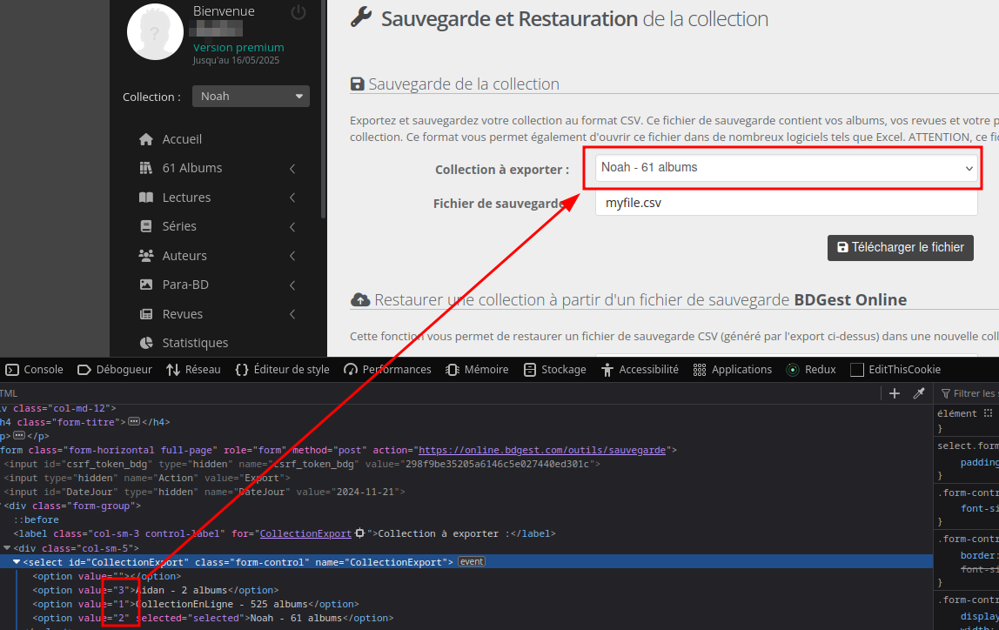

# Export BDgest library to HTML files

This is a simple pet project that fetches CSV out of [BDGest](https://online.bdgest.com/), parse them, and create an HTML file.

## Why

I've been collecting [_bande dessinées_](https://en.wikipedia.org/wiki/Belgian_comics) (Belgian/European/Western comic books, depending on how you call them) since I was a kid. For years I found it hard to keep track of what I had versus what I wanted, but I never really care enough to make something to fix it.

It all changed when my kids started their own collection. What was at worse a medium inconvenience slowly became more and more frustrating. There's nothing sadder than seeing a kid so happy to receive a new comic book, only to realise it is one he already has.

I finally decided to sign up for [BDGest](https://online.bdgest.com/) which was a huge help : The web app works fine, the mobile app allow quick add thanks to the barcode scanner, and I'm able to manage multiple collections (one for me, and one for each of my kids).

Now the problem was that BDGest doesn't include a way to share your collection easily. This was again a mild inconvenience until this happened :


> Which Nelson album is Noah missing?

> Having a look

> Ok
>
> Oh and Kid Paddle as well please

> Yeah OK but my connection is slow
>
> Fuck it's not loading
>
> Oh here we are
>
> I'm gonna list the one he already has
>
> Nelson : 1, 2, 3, 4, 5, 6, 7, 11, 12, 16, 18, 19, 25, 26
>
> Kid Paddle 1, 2, 3, 4, 11, 13, 19 + Best Of : Jurassic Paddle

## How

_This is how it started (November 2024). The scripts have changed since, see [How it works today](#how-it-works-today)._

BDGest provides a way to export collection in CSV. So I started by writing a small bash script (`build_page.sh`) that would open a CSV file, parse it, and write a table into an HTML file.

Since I wanted it to be _somewhat_ pretty but didn't want to have some heavy CSS framework, I used [Pico CSS](https://picocss.com/) to dress my page a little.

I also wanted a way to filter the result, but then again, didn't want any heavy framework, so I wrote some very basic vanilla JS code to filter the table (and yes, I am aware that the header is considered like a standard line - It's ugly, but it works).

Now as much as I was happy with the result, it meant that I had to manually log in to BDGest, export the 3 CSV files, and run my script, which, let's be honest, I would have given up doing before Christmas (I'm writing this the 21st of November)

So I wrote a second script, `get_collection.rb` which responsibility is to log in to BDGest with my login and password, and export the CSV file of the given collection. Then again, it's ugly, but it works.

## Wrapping it up

I finally wrote a `run.sh` script (not included in this repo) that run the two scripts 3 times : once for my collection, once for each of my kids) and then sends the content of the `public` folder on one of my server.
This script is ran once a day through a cronjob.

## What now?

Well, nothing. This is a pet project, it solves a very specific problem of mine, so I consider this code "done".

Most of the code could be refactored, it's under optimized, but for the 3rd time : it's ugly, but it works.

## Dependencies

```sh
uv venv .venv
uv pip install --python .venv/bin/python -r requirements.txt
.venv/bin/playwright install chromium   # the Chromium matching the pinned Playwright
```

`online.bdgest.com` sits behind a Cloudflare challenge that rejects plain HTTP clients (and the headless
Chromium User-Agent), which is why the export runs in a real browser. Update Playwright and its Chromium
regularly (bump `requirements.txt`, then run the commands above): that browser visits a third-party site.

## Configuration

`run.sh` and `deploy.sh` load `~/.config/bd-lists.env` (mode 600):

- `BDGEST_LOGIN` / `BDGEST_PASSWORD` : your BDGest credentials (the pseudo, not the email)
- `BD_SFTP_TARGET` : where `deploy.sh` publishes, `user@host:/dir` (the password is in `.sftpass`)
- `BD_KUMA_PUSH_URL` : (optional) Uptime Kuma push monitor, called by `run.sh` on failure and by `deploy.sh` on success

## Collections

`collections.conf` lists the collections, one per line: `key:BDGest collection id:display name`.
The `COLLECTION_ID` can be found here [Outils > Sauvegarde](https://online.bdgest.com/outils/sauvegarde) by inspecting the values of the `<select>` element



## How it works today

```sh
./run.sh      # export the CSV files into ./tmp, then build ./public
./deploy.sh   # publish ./public (cron: once a day)
```

- `get_collection.py` logs in once in a headless Chromium (only BDGest and the Cloudflare challenge are loaded)
  and writes `tmp/<key>.csv` only if every export is valid.
- `build_pages.py` validates the CSV files (it refuses an error page, or an export that lost more than half of its
  albums), keeps the previous one as `data/<key>.csv.back` and generates, with `templates/layout.html` and `static/`:
  - `<key>.html`: the collection grouped by series, with the owned and missing volumes, and a sortable table view;
  - `a-offrir.html`: everyone's wishlist (albums flagged `Wishlist`, not counted as owned);
  - `index.html`: a global "who already has this album?" search (with barcode scanning where the browser can),
    the counts and the latest purchases;
  - `albums.json` (global search), `sw.js` (offline use), `up` (monitoring).
- `run.sh` refuses to run twice within the hour (`FORCE=1` to override) or concurrently, and keeps `cron.log` small.

The search matches every word: `nelson 12` finds volume 12, an ISBN works with or without dashes, and authors and
publishers are searchable. `noah.html?q=nelson` opens the page already filtered.

### Security and privacy

- Strict Content-Security-Policy: no inline script or style, nothing loaded from third parties (Pico CSS is in `static/`).
- `noindex` and `robots.txt`: the collections (and the kids' first names) stay out of search engines.
- Album links point to Bedetheque, without any affiliation.

## Tests

```sh
.venv/bin/python -m unittest discover -s tests -t .
```

`tests/test_ui.py` drives the generated pages in Chromium (search, table view, global search, mobile layout).

## Monitoring

`build_pages.py` writes `public/up` (`ok <date> cedric=559 noah=115 aidan=25`) only when everything was rebuilt, `deploy.sh` publishes it last as `https://bd.dkmp.be/up`.
Uptime Kuma watches `/up`, each collection page (it must not say "0 albums": keep the `series-count` marker) and a push monitor that expects a run every day.
Run it once a day at most: too many logins get the IP rate limited by Cloudflare (error 1015).
